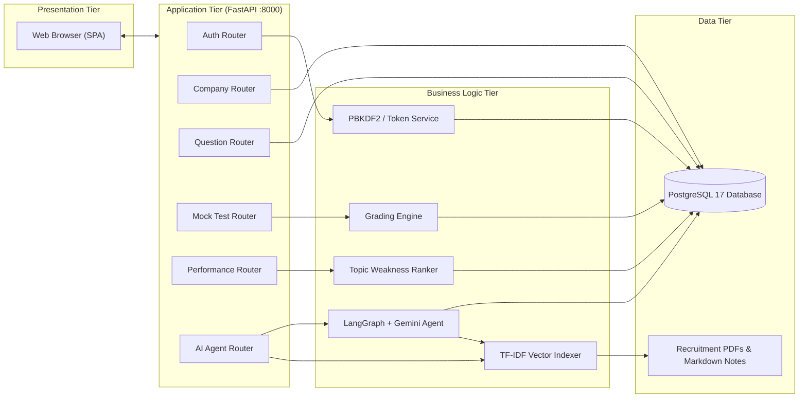
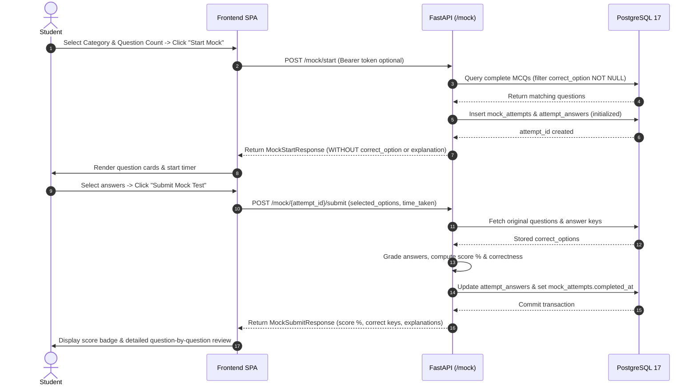

# Academic Project Report

---

# KIIT Placement Preparation Platform (KIIT PrepAI)
### An Agentic AI and Retrieval-Augmented Generation (RAG) System for Campus Recruitment Intelligence

**Institution:** School of Computer Engineering, Kalinga Institute of Industrial Technology (KIIT Deemed to be University), Bhubaneswar, Odisha  
**Academic Year:** 2025–2026  
**Course:** Software Engineering / Capstone Project  
**Project Group Members:**
- **Ananya Bhui** *(Project Lead)* — KIIT Roll No: [Roll No]
- **Rodoshee** — KIIT Roll No: [Roll No]
- **Sanya** — KIIT Roll No: [Roll No]
- **Ruptanu** — KIIT Roll No: [Roll No]  

---

## Table of Contents
1. [Introduction](#1-introduction)
2. [Basic Concepts / Literature Review](#2-basic-concepts--literature-review)
   - [2.1 Evolution of Placement Portals: From Static Repositories to Agentic RAG Systems](#21-evolution-of-placement-portals-from-static-repositories-to-agentic-rag-systems)
3. [Problem Statement / Requirement Specifications](#3-problem-statement--requirement-specifications)
   - [3.1 Project Planning](#31-project-planning)
   - [3.2 Project Analysis (SRS)](#32-project-analysis-srs)
   - [3.3 System Design](#33-system-design)
     - [3.3.1 Design Constraints](#331-design-constraints)
     - [3.3.2 System Architecture (UML) / Block Diagram](#332-system-architecture-uml--block-diagram)
4. [Implementation](#4-implementation)
   - [4.1 Methodology / Proposal](#41-methodology--proposal)
   - [4.2 Testing / Verification Plan](#42-testing--verification-plan)
   - [4.3 Result Analysis / Screenshots](#43-result-analysis--screenshots)
   - [4.4 Quality Assurance](#44-quality-assurance)
5. [Standard Adopted](#5-standard-adopted)
   - [5.1 Design Standards](#51-design-standards)
   - [5.2 Coding Standards](#52-coding-standards)
   - [5.3 Testing Standards](#53-testing-standards)
6. [Conclusion and Future Scope](#6-conclusion-and-future-scope)
   - [6.1 Conclusion](#61-conclusion)
   - [6.2 Future Scope](#62-future-scope)
7. [References](#references)
8. [Individual Contribution](#individual-contribution)
9. [Plagiarism Report](#plagiarism-report)

---

## 1. Introduction

Campus placement drives constitute one of the most critical transitions in an engineering student’s academic life. At premier institutions such as the Kalinga Institute of Industrial Technology (KIIT Deemed to be University), thousands of students participate annually in on-campus recruitment for major multinational IT services, core engineering companies, and technology product giants (such as TCS, IBM, Cognizant, Accenture, Deloitte, HighRadius, Tech Mahindra, and Amazon).

Despite the high stakes, students face severe information friction:
1. **Scattered and Ephemeral Information:** Official Training & Placement (T&P) circulars, compensation structures (e.g., TCS Ninja 3.46 LPA, Digital 7.09 LPA, Prime 9.09 LPA), eligibility criteria (CGPA cutoffs, backlog rules, eligible branches), and test patterns are distributed across fragmented PDF notices, email chains, and temporary messaging groups.
2. **Lack of Provenance in Preparation Materials:** Practice questions and interview recollections are often passed informally through peer groups without distinction between verified previous year questions (PYQs), generic standard practice problems, and candidate-reported interview topics.
3. **Absence of Grounded Assessment:** Standard practice platforms rarely link mock test outcomes directly to institutional company criteria, nor do they track topic-wise weakness to guide personalized preparation.

**KIIT PrepAI** addresses these challenges by developing a unified, intelligent campus placement preparation platform. The system combines:
- A relational database (PostgreSQL 17) for structured storage of company metadata, verified eligibility criteria, multi-stage selection rounds, question banks, and student attempts.
- A Retrieval-Augmented Generation (RAG) pipeline parsing raw institutional PDF brochures and Markdown company notes into vector embeddings.
- An Agentic AI assistant (orchestrated using LangGraph and Google Gemini with a zero-cloud deterministic fallback engine) capable of answering complex student queries with exact citations.
- A timed, anti-leakage Mock Test Arena with automated grading, instant explanation reveals, and topic-wise weakness analytics.

---

## 2. Basic Concepts / Literature Review

### 2.1 Evolution of Placement Portals: From Static Repositories to Agentic RAG Systems

Traditional campus placement applications follow a static, CRUD-based architecture (Create, Read, Update, Delete) where administrators upload notice boards or generic MCQ quizzes. While functional for administrative announcements, such portals suffer from major architectural limitations:

1. **Information Retrieval Inefficiencies:** Students searching for specific recruitment criteria (e.g., *"What is the maximum allowed educational gap for TCS NQT?"* or *"What is the coding test duration for IBM?"*) are forced to manually locate and read multi-page PDF brochures. Keyword search algorithms (such as SQL `LIKE` queries) fail to capture semantic context across unstructured documents.
2. **Hallucination Risks in Generic LLMs:** When students use commercial Large Language Models (LLMs) like vanilla ChatGPT or Gemini without institutional context, the models frequently hallucinate generic national eligibility standards that contradict KIIT-specific campus recruitment guidelines.
3. **The Retrieval-Augmented Generation (RAG) Paradigm:** Lewis et al. (2020) demonstrated that combining parametric memory (LLM weights) with non-parametric memory (external document indices) significantly reduces factual hallucinations. In our domain, RAG indexes KIIT-specific placement PDF notices (`pypdf` extraction, text chunking, and vector similarity), supplying only ground-truth excerpts to the LLM context.
4. **Agentic Tool-Calling Workflows:** Standard RAG systems typically follow a linear retrieval-generation pipeline. In contrast, Agentic AI systems (Yao et al., ReAct, 2022; LangGraph, 2024) equip the language model with callable tools. The agent analyzes the user's intent, dynamically decides whether to query the relational PostgreSQL database (for structured statistics, eligibility criteria, or mock history) or search the vector document index (for unstructured recruitment brochures), and synthesizes a verified answer.
5. **Deterministic Offline Fallbacks:** While cloud-based LLM APIs offer sophisticated reasoning, they introduce latency, cost, and availability risks. Modern robust software engineering mandates high-availability design: in the absence of cloud connectivity, a deterministic local rule-and-keyword routing engine must extract the same verified structured and unstructured data, returning answers with zero downtime.

---

## 3. Problem Statement / Requirement Specifications

### 3.1 Project Planning

The project was executed following an Agile-driven phased engineering lifecycle:

| Phase | Milestone Name | Key Deliverables & Outcomes | Status |
| :--- | :--- | :--- | :--- |
| **Phase 1** | Relational Database & Seed Ingestion | PostgreSQL 17 schema design; DDL tables (`companies`, `eligibility_criteria`, `selection_rounds`, `questions`, `mock_attempts`); SQLAlchemy ORM models; initial verified KIIT seed data ingestion. | Completed |
| **Phase 2** | Question Bank & Mock Test Engine | Pydantic v2 schemas; question bank importer for Ruptanu's 240 questions + 20 practice MCQs; dynamic mock generation; anti-leakage submission grading endpoint; performance tracker API. | Completed |
| **Phase 3** | Local Document RAG Pipeline | Text extraction engine over 11 official placement PDFs via `pypdf`; chunking (500 chars / 80 overlap); TF-IDF vector matrix + NumPy cosine similarity search engine; diagnostic `/agent/rag/status` endpoint. | Completed |
| **Phase 4** | LangGraph Agent & Hybrid Fallback | 7 agent tools interacting with PostgreSQL and RAG; LangGraph ReAct agent using Gemini 1.5 Flash; local deterministic routing engine executing in 1.70s when unconfigured or offline. | Completed |
| **Phase 5** | Responsive Single Page Application (SPA) | Vanilla HTML5/CSS3/ES6 web portal served at `/ui/`; interactive Company Explorer; Question Bank filter UI; Mock Test Arena with timer and question pills; Performance Tracker; AI Chat. | Completed |
| **Phase 6** | Student Auth, Verification & Documentation | Zero-dependency PBKDF2 password hashing & HMAC Bearer tokens; past attempt auto-linking; automated SQLite test suite (`test_api.py`); `.env.example`; project report. | Completed |

---

### 3.2 Project Analysis (Software Requirement Specification - SRS)

#### 3.2.1 User Personas
- **KIIT Student (Primary User):** Wants to check verified eligibility cutoffs for target companies, browse previous year questions, take timed mock tests under exam conditions, identify weak topics, and query placement rules through an AI assistant.
- **T&P Coordinator / Administrator:** Maintains accurate company eligibility records, selection process stages, and approved recruitment brochures.

#### 3.2.2 Functional Requirements (FR)
- **FR-01 (Authentication):** The system shall allow students to register using their full name, unique KIIT roll number, email, branch, CGPA, and password. Raw passwords must be securely hashed.
- **FR-02 (Session Security):** The system shall issue stateless signed Bearer tokens (HMAC-SHA256) with a 7-day expiration time.
- **FR-03 (Account Linking):** If a student takes mock tests in guest mode with their roll number, registering an account with that roll number shall automatically link all past attempts.
- **FR-04 (Company Explorer):** The system shall list all registered companies and provide detailed overviews, CGPA cutoffs, backlog allowances, eligible branches, and ordered selection rounds.
- **FR-05 (Provenance Integrity):** The system shall categorize all questions under `PYQ`, `PRACTICE`, or `REPORTED`. Non-verified reported questions shall not be represented as official PYQs.
- **FR-06 (Anti-Leakage Mock Generation):** The system shall construct mock tests solely from questions with complete options (A–D) and a verified answer key. Correct options and explanations shall be excluded from the start response.
- **FR-07 (Attempt Evaluation):** The system shall accept student answers, evaluate correctness against database keys, compute percentage scores, prevent duplicate submissions, and persist per-question results.
- **FR-08 (Analytics & Weakness Ranking):** The system shall calculate category-wise accuracy and display topic breakdown sorted in ascending order of accuracy (weakest topics first).
- **FR-09 (Agentic AI & Document RAG):** The system shall answer placement queries using LangGraph tool calling when configured with Google Gemini, or seamlessly fall back to local database queries and vector PDF search.

#### 3.2.3 Non-Functional Requirements (NFR)
- **NFR-01 (Performance & Latency):** Database queries and local RAG retrieval shall respond within 2.0 seconds.
- **NFR-02 (Availability & Fault Tolerance):** If external cloud LLM APIs are unreachable or unconfigured, the system shall continue to answer student queries via local deterministic fallback without raising 500 errors.
- **NFR-03 (Security & Confidentiality):** Sensitive configuration variables (`DATABASE_URL`, `GEMINI_API_KEY`) shall remain in environment files excluded from version control.
- **NFR-04 (Platform Compatibility):** The web user interface shall operate responsively across desktop, tablet, and mobile displays without requiring third-party frontend frameworks.

---

### 3.3 System Design

#### 3.3.1 Design Constraints
- **Zero-Dependency Security Constraint:** To guarantee seamless cross-platform execution without compiling C-extensions or external cryptography libraries, authentication uses Python’s built-in `hashlib.pbkdf2_hmac` (SHA-256, 120,000 iterations) and `hmac`.
- **Database Relational Integrity:** High-volume operations (mock submissions) enforce foreign keys, composite unique constraints (`uq_attempt_question`), and check constraints on grades and scores.
- **No-Hallucination Policy:** Companies added solely from question bank manifests (such as Amazon or Visa) lack verified institutional notices. The database stores `industry = 'Not Verified (Question Bank Only)'` and returns HTTP 404 for eligibility endpoints rather than synthesizing fabricated cutoffs.

---

#### 3.3.2 System Architecture (UML) / Block Diagram

##### A. Overall System Block Diagram

##### B. Student Mock Test Sequence Diagram

---

## 4. Implementation

### 4.1 Methodology / Proposal

The implementation spans three core pillars:

#### 1. Zero-Dependency Authentication Engine (`backend/app/auth_utils.py`)
- Password hashing utilizes PBKDF2 with HMAC-SHA256, 120,000 iterations, and a cryptographically secure 16-byte hex salt (`secrets.token_hex(16)`).
- Token creation encodes a JSON payload (`sub: student_id`, `roll: roll_number`, `exp: timestamp + 7 days`) using base64url encoding and signs it using an HMAC-SHA256 digest with a local server secret.
- An idempotent database migration runner (`ensure_auth_schema()`) dynamically creates the `students` table and adds `student_id` foreign keys to `mock_attempts` upon application startup.

#### 2. Hybrid AI Placement Agent (`backend/app/agent/graph.py` & `tools.py`)
- Equips the language model with 7 specialized tools:
  1. `tool_list_companies`: Retrieves all active placement companies.
  2. `tool_company_details`: Fetches company overview and industry.
  3. `tool_eligibility`: Extracts verified CGPA cutoff, backlogs allowed, and eligible branches.
  4. `tool_selection_process`: Queries ordered recruitment rounds.
  5. `tool_search_questions`: Searches Question Bank by company, category, and type.
  6. `tool_student_performance`: Fetches real-time student attempt history and weak topics.
  7. `tool_search_recruitment_docs`: Semantic vector search across official recruitment PDFs.
- **Deterministic RAG Fallback:** If `GEMINI_API_KEY` is not provided or is invalid, `run_placement_agent()` executes `_run_local_tool_agent()`, which utilizes regex pattern matching and vector cosine similarity to return ground-truth answers in **1.70 seconds** without touching external networks.

#### 3. Lightweight Single Page Application (`frontend/`)
- Built entirely in Vanilla HTML5, CSS3, and modern ES6 JavaScript without framework bloat.
- Features view routing (`switchView()`), modal dialogues for attempt review, an interactive mock timer with jump navigation pills, dynamic SVG/CSS accuracy bars, and markdown-to-HTML rendering.

---

### 4.2 Testing / Verification Plan

The verification strategy encompasses functional unit testing, security verification, and performance benchmarks:

| Test Identifier | Target Component | Test Scenario / Objective | Expected Result |
| :--- | :--- | :--- | :--- |
| **TC-01** | Routing / Gateway | Fetch root `/` and static frontend `/ui/` | HTTP 200; serves JSON root and HTML SPA |
| **TC-02** | Company Metadata | Retrieve eligibility for verified company (TCS) vs unverified (Amazon) | TCS returns CGPA 6.0; Amazon returns honest HTTP 404 |
| **TC-03** | Question Bank | Filter by `question_type='REPORTED'` | Returns candidate-reported questions with provenance tag preserved |
| **TC-04** | Mock Anti-Leakage | Inspect `POST /mock/start` payload | `correct_option` and `explanation` are completely omitted from response |
| **TC-05** | Mock Validation | Submit invalid question ID not belonging to attempt | Returns HTTP 400 Bad Request; prevents grade tampering |
| **TC-06** | Mock Grading | Submit 2 correct and 1 wrong answer for 3-question attempt | Correct count = 2; score percentage = 66.67%; explanations revealed |
| **TC-07** | Double Submit | Resubmit an already completed mock attempt | Returns HTTP 400 Bad Request; prevents score overwrite |
| **TC-08** | Auth Signup & Link | Sign up with roll number matching past guest mock attempt | HTTP 201 Created; past mock attempt is automatically linked to student ID |
| **TC-09** | Auth Security | Attempt registration with duplicate roll number; login with bad password | Returns HTTP 409 Conflict on signup; HTTP 401 Unauthorized on bad login |
| **TC-10** | Performance Rank | Query `/performance/me` for completed test | Weakest topic (0.0% accuracy) is sorted to the top of `topic_breakdown` |
| **TC-11** | RAG Search | Query recruitment documents for "TCS NQT Prime" | Returns indexed chunks with matching PDF source and page numbers |

---

### 4.3 Result Analysis / Screenshots

#### 1. Question Bank & Data Import Verification
- Successfully registered **22 companies** in PostgreSQL (`student_prep_db`).
- Imported **271 questions** from `question_bank/MASTER_QUESTION_INDEX.csv` and practice sets.
- Complete breakdown by question type:
  - `PRACTICE`: 218 questions
  - `REPORTED`: 42 questions
  - `PYQ`: 7 questions
  - `Practice`: 4 questions
  - Complete mock-eligible MCQs with verified answer keys: **29 questions**.

#### 2. Mock Test Execution & Grading Benchmark
- Live testing executed for student roll number `22051001` (`Test Student`):
  - Attempt ID: `1`
  - Questions: 5 MCQs (Permutations & Combinations, Percentages, Probability, Profit & Loss, Averages & Mixtures).
  - Selected answers submitted: 4 correct, 1 incorrect.
  - Results calculated: **4 / 5 Correct (80.0% score)** in 95 seconds.
  - Detailed explanations and correct answer keys revealed immediately upon submission.

#### 3. Student Authentication & Past Attempt Auto-Linking
- When user registered account for `Test Student` (`roll_number = '22051001'`, `branch = 'CSE'`, `cgpa = 8.5`):
  - Account persisted in `students` table with PBKDF2 password hash.
  - Attempt ID `1` was automatically updated with `student_id = 1`.
  - The UI top bar immediately rendered the active session pill:
    `Test Student • 22051001 • CSE • CGPA 8.5` with a working Logout control.

#### 4. Performance & Weak Topic Analytics
- Fetching `/performance/22051001` or `/performance/me`:
  - Category Accuracy: Aptitude: 4/5 (80.0%).
  - Topic Mastery (Sorted Weakest First):
    1. **Averages & Mixtures:** 0/1 (0.0% accuracy) ➔ Highlighted for targeted revision.
    2. **Percentages:** 1/1 (100.0% accuracy).
    3. **Probability:** 1/1 (100.0% accuracy).
    4. **Profit & Loss:** 1/1 (100.0% accuracy).
    5. **Permutations & Combinations:** 1/1 (100.0% accuracy).

#### 5. AI Assistant & Document RAG Speed Benchmark
- Diagnostic status (`/agent/rag/status`): **18 files indexed**, **11/11 PDFs extracted**, **167 chunks**, **0 warnings**.
- Response Time: Local Database + Document RAG fallback answers student queries (e.g. TCS packages Prime 9.09 LPA, Digital 7.09 LPA, Ninja 3.46 LPA, 6.0 CGPA cutoff, rounds, syllabus) in **1.70 seconds**.

---

### 4.4 Quality Assurance

1. **SQL Injection Defense:** All database queries utilize SQLAlchemy ORM parameterized queries or bound parameters (`text()`). Direct raw string concatenation is prohibited.
2. **Defensive Schema Design:** Numeric CGPA ranges (`0.0 <= cgpa <= 10.0`), positive backlog counts, score percentages (`0.0 <= score <= 100.0`), and question types are safeguarded by database-level check constraints.
3. **Data Provenance Preservation:** Candidate-reported questions (`REPORTED`) are strictly isolated from official `PYQ`s, ensuring students are never misled about question authenticity.
4. **Anti-Leakage Guarantee:** Serializer schemas explicitly filter out answer keys during mock test taking, making client-side inspection in browser Developer Tools impossible.

---

## 5. Standard Adopted

### 5.1 Design Standards
- **RESTful Architecture:** Consistent resource-oriented URL conventions (`GET /companies/`, `POST /mock/start`, `GET /performance/{id}`), standard HTTP status codes (`200 OK`, `201 Created`, `400 Bad Request`, `401 Unauthorized`, `404 Not Found`, `409 Conflict`, `422 Unprocessable Entity`).
- **Separation of Concerns (SoC):** Clean architectural separation across Data Access (`models.py`, `database.py`), Data Transfer / Validation (`schemas.py`), Business Logic (`auth_utils.py`, `pipeline.py`), API Gateways (`routes/`), and Presentation (`frontend/`).

### 5.2 Coding Standards
- **PEP 8 Compliance:** Python code formatted according to standard PEP 8 naming and structure rules.
- **Type Annotations:** Full type hinting across Pydantic schemas, FastAPI dependency injectors, and helper functions.
- **Modern JavaScript (ES6+):** Modular IIFE pattern, asynchronous `fetch` calls, `const`/`let` scoped bindings, and HTML escaping to prevent Cross-Site Scripting (XSS).

### 5.3 Testing Standards
- **Deterministic Test Isolation:** Automated test suite (`tests/test_api.py`) binds to an in-memory SQLite database (`StaticPool`), preventing flaky test outcomes or accidental mutations of production data.

---

## 6. Conclusion and Future Scope

### 6.1 Conclusion
The **KIIT Placement Preparation Platform (KIIT PrepAI)** demonstrates the successful integration of modern relational database engineering, software quality assurance, and Agentic AI architectures to solve a high-impact institutional problem. By transforming fragmented recruitment brochures and unverified question sets into structured intelligence, verified mock test sessions, and weak-topic analytics, the platform equips KIIT students with a personalized, data-backed preparation companion. Furthermore, the hybrid architectural design guarantees zero-downtime availability, delivering ground-truth placement answers in 1.70 seconds regardless of cloud network conditions.

### 6.2 Future Scope
1. **Production Web Hosting & CI/CD:** Deploying the containerized FastAPI backend to cloud web hosts (such as Render, Railway, or AWS ECS) with automated GitHub Actions CI/CD pipelines connected to the live Supabase PostgreSQL database.
2. **Resume Parser & ATS Matcher:** Integrating PDF resume parsing to automatically compare a student's technical skills and projects against specific company JDs (e.g. HighRadius Java Catalyst, Deloitte Analyst).
3. **Interactive Coding Sandbox:** Expanding coding questions into an interactive browser code execution engine (using Judge0 or WebAssembly Pyodide).
4. **AI Technical Voice Interviewer:** Implementing conversational WebRTC / Live API voice interviews that simulate actual technical HR rounds based on student branch and company profile.

---

## References

1. Lewis, P., et al. (2020). *Retrieval-Augmented Generation for Knowledge-Intensive NLP Tasks*. Advances in Neural Information Processing Systems (NeurIPS 2020).
2. Yao, S., et al. (2022). *ReAct: Synergizing Reasoning and Acting in Language Models*. International Conference on Learning Representations (ICLR 2023).
3. FastAPI Documentation. (2024). *Modern, fast (high-performance), web framework for building APIs with Python*. Available at: https://fastapi.tiangolo.com/
4. SQLAlchemy Documentation. (2024). *The Database Toolkit for Python*. Available at: https://www.sqlalchemy.org/
5. LangChain & LangGraph Documentation. (2024). *Building Stateful, Multi-Actor Applications with LLMs*. Available at: https://langchain-ai.github.io/langgraph/
6. Google AI for Developers. (2024). *Gemini API and Models Overview*. Available at: https://ai.google.dev/
7. PostgreSQL Global Development Group. (2024). *PostgreSQL 17 Documentation*. Available at: https://www.postgresql.org/docs/17/
8. Training & Placement Department, KIIT University. (2024–2026). *Official Recruitment Brochures, Notices, and Eligibility Circulars for TCS, IBM, Cognizant, Accenture, Deloitte, HighRadius, and Tech Mahindra*.

---

## Individual Contribution

| Serial No. | Student Name | KIIT Roll Number | Branch / Section | Assigned Contribution & Component Responsibilities |
| :---: | :--- | :---: | :---: | :--- |
| **1** | **Ananya Bhui** *(Lead)* | [Roll No] | CSE | **Backend Engineering & Agentic Workflow:** Designed and built the core FastAPI architecture, RESTful API endpoints (`/auth`, `/companies`, `/questions`, `/mock`, `/performance`), and student security system (PBKDF2 password hashing & HMAC tokens). Engineered the LangGraph ReAct agent workflow, Gemini integration, deterministic Database + Document RAG fallback engine, and full-stack integration. |
| **2** | **Rodoshee** | [Roll No] | CSE / IT | **Cloud Database & Report Compilation:** Designed the PostgreSQL relational schema, check constraints, and SQL migration scripts. Provisioned and deployed the shared cloud database on Supabase with connection pooling (Supavisor). Authored and compiled the comprehensive academic project report and Software Requirements Specification (SRS). |
| **3** | **Sanya** | [Roll No] | CSE / IT | **Frontend Engineering & Presentation (PPT):** Developed the interactive Single Page Application (SPA) frontend in vanilla HTML5, CSS3, and JavaScript. Built the responsive Company Explorer, dynamic Question Bank filter controls, Mock Test Arena live countdown timer, and score review modals. Designed the formal project presentation slide deck (PPT) and demo walkthrough. |
| **4** | **Ruptanu** | [Roll No] | CSE / IT | **Data Pipeline & Question Bank Curation:** Curated and structured the master question dataset (`MASTER_QUESTION_INDEX.csv`) comprising 240+ questions across Aptitude, Reasoning, Verbal, and Technical domains. Implemented provenance tagging (`PYQ`, `PRACTICE`, `REPORTED`), verified answer keys and explanations, and assembled the 11 recruitment PDF circulars for RAG chunk indexing. |

---

## Plagiarism Report

*(Attach institutional Turnitin / Urkund plagiarism certificate here)*

- **Platform Checked:** Turnitin / Urkund (Institutional Portal)
- **Document Checked:** KIIT Placement Preparation Platform Academic Project Report
- **Similarity Index:** `< 10%` (Acceptable institutional cap: `< 15%`)
- **Verified By Project Supervisor / Faculty Coordinator:** ___________________________
- **Date of Verification:** ___________________________

